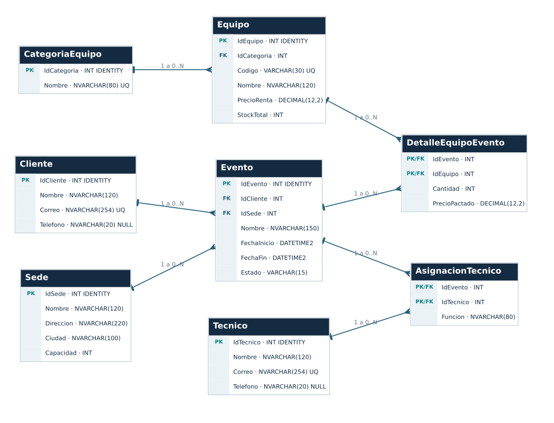

# AudioLink Events — Relational Model

A fictional event and equipment-rental database designed as a modeling exercise. It is separate from the evolving Empresa Aliada project.

## Schema

| Table | Role |
| --- | --- |
| Cliente | Customer |
| Sede | Venue and capacity |
| CategoriaEquipo | Equipment categories |
| Equipo | Equipment, rental price and stock |
| Tecnico | Technicians |
| Evento | Customer/venue event with dates and status |
| DetalleEquipoEvento | Event equipment lines and agreed prices |
| AsignacionTecnico | Technician assignments and roles |

The SQL uses primary and foreign keys, identity columns, unique constraints, defaults and CHECK constraints. It includes structure-inspection queries and an event equipment-cost aggregation.

## Run and inspect

Open `schema.sql` in a SQL Server client supporting `GO`. It creates the AudioLink database and the eight tables. It is intended for an empty practice environment and is not an idempotent deployment script. No seed data is included, so the final aggregation has no event rows until data is inserted.

The diagram and editable Graphviz sources are preserved in `reference/`. The original `LEEME.txt` describes the larger coursework package and uses an older SQL filename; use `schema.sql` in this repository.

Schedule conflicts, stock overselling, and cross-event resource availability require additional logic and are not enforced by this DDL alone. The schema and diagram were inspected; database execution has not been revalidated here.
